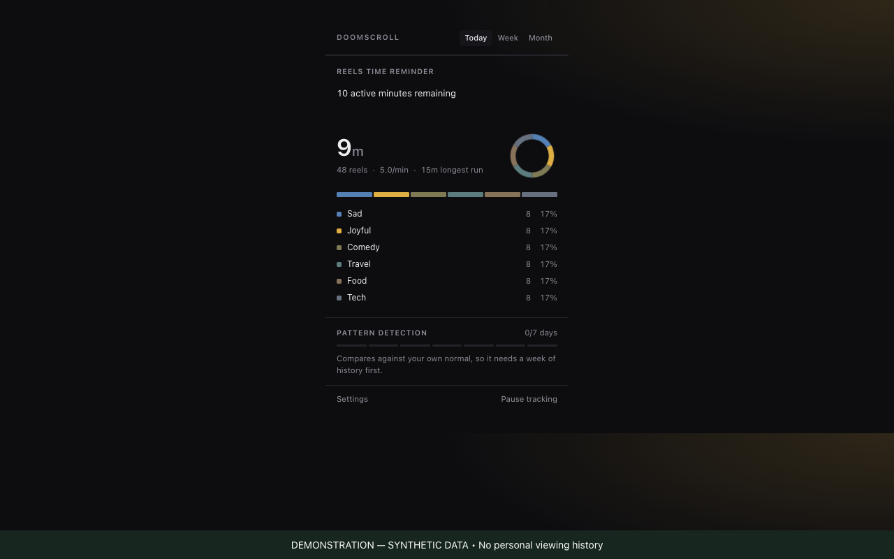
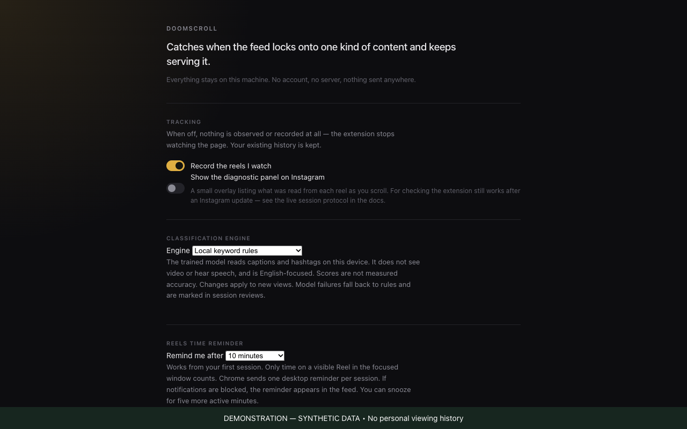
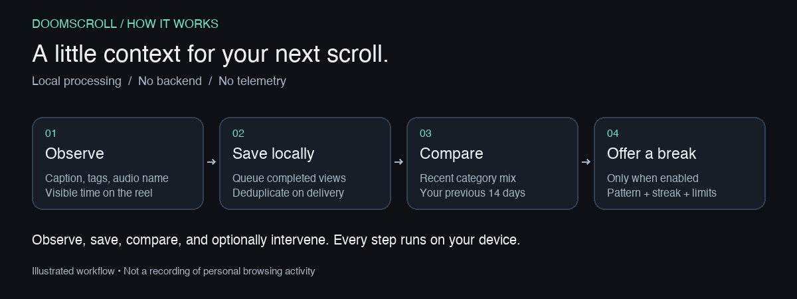
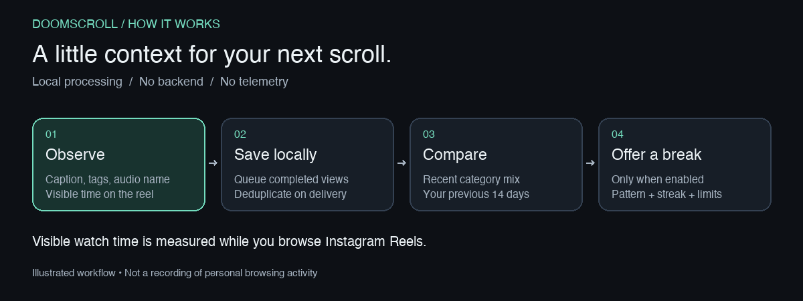
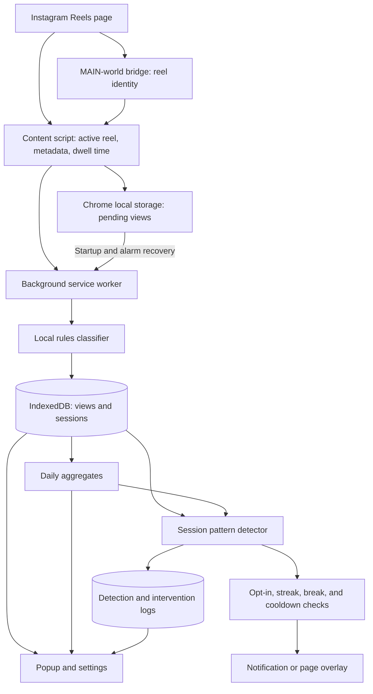

<p align="center">
  
</p>

# Doomscroll

**See what your Instagram Reels feed keeps showing you—and make room for a break.**

Doomscroll is a local Chrome extension that records visible watch time, groups
reels by text-derived categories, and flags when your feed becomes unusually
repetitive compared with your own recent history. A compact dashboard makes
viewing patterns easier to inspect; optional prompts help you step away.

All classification and storage run on your device. The extension has no backend,
telemetry, cloud model, or separate account. Its labels describe the content
shown in your feed, not your mood or mental health. Doomscroll is not
affiliated with Instagram, Meta, or Google.

Publishing to the Chrome Web Store follows [docs/store-listing.md](docs/store-listing.md).
Copy that listing as written. Do not add claims the privacy policy does not
already make.

**Version 1.1.0 · Manifest V3 · Chrome 116+ · All rights reserved**

> **Release candidate:** automated tests cover the application and packaged
> extension. Live Instagram acceptance testing is only partially complete, and
> a multi-user beta is still pending. See [release readiness](docs/release-readiness.md)
> for the remaining gates.

[Install](#install-locally) · [Screenshots](#a-look-inside) ·
[How it works](#how-it-works) · [Privacy](#privacy-and-data-control) ·
[Development](#development-and-testing) · [Troubleshooting](#troubleshooting)

## A look inside

These screenshots show the actual extension using **synthetic demonstration
data**. They contain no personal viewing history.

### Your feed at a glance



Switch between **Today**, **Week**, and **Month**. The popup shows watch time,
reel count, pace, and the longest run, with the category mix drawn twice: a
ring beside the time and a bar under it. The same numbers feed both. A trend
of emotionally charged share appears once enough days exist. Bars grow in and
the trend line draws itself; that motion stays off when the system asks for
reduced motion. Tracking can be paused from the popup.

The screenshot above is a synthetic capture of the report. Rebuild and reload
the extension to see the current ring and motion.

### Controls you can inspect



The settings page brings together tracking controls, pattern thresholds,
watched categories, sessions, creator statistics, detection logs, intervention
history, extraction health, and CSV exports.

## What you can do

| Feature                 | What it provides                                                                              |
| ----------------------- | --------------------------------------------------------------------------------------------- |
| Track completed views   | Record the reel identifier, visible watch duration, timestamps, and available text metadata.  |
| Understand your feed    | Browse category breakdowns, daily trends, sessions, and creator statistics.                   |
| Spot unusual repetition | Compare recent content with a recency-weighted baseline from your own previous fourteen days. |
| Choose interruptions    | Enable notifications, full-screen prompts, or prompts with a short dismissal delay.           |
| Take a break            | Leave the Reels feed and receive a reminder if you return during a fifteen-minute break.      |
| Inspect decisions       | See detection reasons, delivered prompts, responses, and failed delivery counts.              |
| Diagnose extraction     | A page notice when reel identity cannot be read, plus health details in Settings.             |
| Control your data       | Pause tracking, export three separate CSV datasets, or delete tracked history.                |

## Install locally

### Requirements

- A current desktop Chrome browser; the manifest's minimum is **Chrome 116**.
- **Node.js 22.12+ within the 22.x line, or Node.js 24+**, with npm.
- Git to clone the repository.
- `zip` and `unzip` for release packaging and packaged browser tests.

Chrome's minimum API version is not a guarantee that every older release has
been tested. See [browser compatibility](docs/browser-compatibility.md).

### Build and load

```sh
git clone https://github.com/sogoyalz/Doomscroll.git
cd Doomscroll
npm ci
npm run build
```

1. Open `chrome://extensions` in Chrome.
2. Turn on **Developer mode**.
3. Choose **Load unpacked** and select the generated **`dist/`** directory.
4. Pin Doomscroll from Chrome's Extensions menu for quick access.
5. Open Instagram Reels at `https://www.instagram.com/reels/` and browse normally.
6. Open the popup to inspect recorded views; use **Settings** for the detailed dashboard.

Load `dist/`, not the repository root. After changing source code, rebuild,
reload the extension on `chrome://extensions`, and refresh open Instagram tabs.

### What to expect on the first day

Tracking starts enabled. Interventions and the on-page diagnostic panel start
switched off. The extension can show viewing statistics immediately, but it
waits for sufficient history before flagging unusual patterns or allowing
interventions to be enabled in settings.

A view is recorded when it finishes, such as when you move to another reel.
Very fast passes under **250 milliseconds** are ignored. The watch-time clock
excludes hidden-tab time and time spent under an extension overlay; it does not
measure attention or whether you actually watched the video.

## How it works



<details>
<summary>Animated workflow (optional)</summary>



Illustration only; this is not a recording of Instagram activity. The animation
plays twice. The static diagram above contains the same workflow.

</details>

### 1. Observe the active reel

The content script identifies the reel around the viewport midpoint and reads
its caption, hashtags, audio attribution, and creator handle when available.
A separate MAIN-world bridge reads the identity from React's player data,
supporting both `media.code` and numeric `mediaId` layouts. If that fails, the
extractor uses a creator/video-filename fallback.

Metadata that arrives late is merged with the initial reading. A view's recorded
watch duration is capped at ten minutes to limit runaway timers. Sessions use
a configurable inactivity gap, defaulting to two minutes.

### 2. Save and deliver together

When a view finishes, the content script starts the local queue write and the
message to the service worker in the same moment. It does not wait for the
save to finish before sending. The worker assigns the session, classifies the
view, and writes history to IndexedDB. Unique event IDs make a retry safe: it
does not add another view or inflate session totals.

Recovery runs when the worker starts and through a periodic alarm. Historical
recovery updates history without interrupting an unrelated tab. A recent live
message can still deliver an eligible prompt if recovery saved its view first.

### 3. Classify the available text

The classifier uses a local weighted lexicon: curated hashtags, phrases,
individual words, and emoji. Audio titles receive a lower weight than authored
caption text. It produces a category, a heuristic confidence score, and matched
terms; that score is not a calibrated probability.

| Category group                                     | Labels                                                                                                         |
| -------------------------------------------------- | -------------------------------------------------------------------------------------------------------------- |
| Emotional categories, called “charged” in the code | Joyful, sad, breakup, anxious, angry, motivational, romantic                                                   |
| Topics                                             | Comedy, music, dance, food, fitness, sports, tech, fashion, travel, gaming, pets, art, entertainment, learning |
| Neutral                                            | Readable text that did not produce a qualifying category match                                                 |
| Unclassified                                       | No usable text signal; stored separately from neutral                                                          |

The default classifier uses **local rules**. Settings also offers a trained local
DeBERTa model (`local-ml`) for new views. There is no image understanding,
speech transcription, comment-thread analysis, or remote inference.

A category written in the caption or hashtags decides the reel. A song title,
or hearts used as decoration, does not replace that category. A caption that
is only a heart is still romantic, and a song title is used when the caption
names no category.

### 4. Compare with your own baseline

Detection uses the current session's recent views and the previous fourteen
local calendar days, excluding today. Baseline counts are weighted toward
recent days with a seven-day half-life.

The default decision requires all of the following:

| Check                | Default requirement                                                                            |
| -------------------- | ---------------------------------------------------------------------------------------------- |
| History              | At least 7 nonempty days within the previous 14 days                                           |
| Baseline sample      | At least 20 charged reels across those days                                                    |
| Recent window        | The latest 15 views in the current session                                                     |
| Readable sample      | At least 8 classified views in that window                                                     |
| Charged sample       | At least 5 charged views in that window                                                        |
| Dominance            | One category represents at least 60% of the window's charged content                           |
| Change from baseline | That category's share is at least 1.5 times its baseline share                                 |
| Watched category     | The dominant category is selected for detection; defaults are sad, breakup, anxious, and angry |

**The denominator matters:** dominance is measured among charged categories,
not all watched reels. Topics, neutral content, and unclassified views do not
contribute to that denominator. Statistics in the popup can use a different
denominator because they describe the full feed.

The log records why detection did not fire as well as positive findings.
Repeated matching outcomes are collapsed into entries with occurrence counts.

## Optional prompts and breaks

Detection and intervention are separate. A detected pattern only leads to a
prompt when interventions are enabled, the streak threshold is met, and the
cooldown and session limits permit it.

| Level               | Default classified streak | Behavior                                                         | Cooldown between sessions |
| ------------------- | ------------------------- | ---------------------------------------------------------------- | ------------------------- |
| Notification        | 5                         | A local Chrome notification; requires optional permission        | 10 minutes                |
| Full-screen prompt  | 10                        | Offers **Take a break** or **Keep scrolling**                    | 20 minutes                |
| Prompt with a delay | 20                        | Keeps **Take a break** available; delays dismissal by 10 seconds | 30 minutes by default     |

Each level can fire at most once per session. The strongest eligible level is
chosen directly; a long streak does not have to pass through every weaker
prompt first. Unclassified reels neither extend nor break a classified streak.
Streak counting spans the session independently of the fifteen-view window.
The ladder values above are defaults in code; not every value is exposed as a
settings control.

Accepting a break leaves the Reels feed for Instagram's home page and stores a
**fifteen-minute break**. Returning to Reels during that interval can show a
reminder, with an option to end the break. It does not lock the browser or track
activity on other devices.

Failed delivery is retried with a one-minute delay per level and does not spend
the once-per-session allowance. The history panel separates failed delivery
attempts from shown prompts; legacy records without delivery metadata remain
included. “No early end recorded” means no early-ending request was received,
not proof that scrolling stopped.

## Architecture



The worker serializes history writes and extraction-health updates, so two tabs
cannot drop a sample by saving at the same time. Settings reads can bypass that
queue. Statistics requests stay inside it because they also refresh daily
aggregates. Exports, deletion, and settings changes are accepted only from
extension pages.

| Location                               | Responsibility                                                                                           |
| -------------------------------------- | -------------------------------------------------------------------------------------------------------- |
| [`src/content/`](src/content/)         | DOM extraction, identity bridge, dwell clock, overlays, navigation, diagnostic HUD                       |
| [`src/background/`](src/background/)   | Message routing, session assignment, IndexedDB, aggregation, detection, interventions, maintenance       |
| [`src/shared/`](src/shared/)           | Classifier and lexicon, detection rules, settings validation, CSV encoding, analytics, message contracts |
| [`src/popup/`](src/popup/)             | Watch time, category ring and bar, trend, and detection status                                           |
| [`src/options/`](src/options/)         | Settings, sessions, creators, logs, extraction health, tuning, data controls                             |
| [`tests/`](tests/)                     | Unit and integration tests, including IndexedDB and message-pipeline behavior                            |
| [`e2e/`](e2e/)                         | Packaged-extension tests in isolated Chromium profiles                                                   |
| [`scripts/`](scripts/)                 | Packaging, private-data checks, evaluation, labeling support, demonstration screenshots                  |
| [`tools/label.html`](tools/label.html) | Local manual labeling interface for evaluation                                                           |
| [`docs/`](docs/)                       | Architecture, internals, live validation, beta criteria, and release guidance                            |

Built with **TypeScript, React 18, Vite, the CRXJS Vite plugin, and `idb`**.
Tests use **Vitest, jsdom, fake-indexeddb, and Playwright**.

## Privacy and data control

The extension's processing is local. It does not send viewing data to a server.
Instagram itself still operates as a networked website; the extension does not
make Instagram browsing offline.

| Data                                                                                     | Storage and retention                                                            |
| ---------------------------------------------------------------------------------------- | -------------------------------------------------------------------------------- |
| Per-view identifiers, captions, hashtags, audio names, creators, timings, and categories | IndexedDB; raw history is pruned after 90 days                                   |
| Sessions, detection logs, intervention logs                                              | IndexedDB; pruned under the 90-day history retention policy                      |
| Daily summaries                                                                          | IndexedDB; retained until you delete history                                     |
| Settings, session state, cooldowns, diagnostics, break state                             | Chrome local storage                                                             |
| Pending completed views                                                                  | Chrome local storage; expire after 24 hours and are removed on pause or deletion |

Use the settings page to export reels, detection logs, and intervention logs as
**three separate CSV files**. Export encoding guards against spreadsheet formula
injection. Exports still contain sensitive viewing information, including
creator handles and captions, and should remain outside the repository.

Pausing stops observation and recording while keeping existing history.
Deleting history also clears pending views and associated break/session state;
preferences remain. Direct and Accounts surfaces are excluded on fresh loads
and in-app navigation. No mobile Instagram or other-device activity is tracked.

Permissions are limited to `storage`, `alarms`, Instagram host access, and
optional `notifications`. Read the [privacy policy](PRIVACY.md) and
[security documentation](docs/security.md) for details.

## Development and testing

```sh
npm ci
npx playwright install chromium
npm run verify
```

`verify` runs typecheck, lint, unit/integration tests, a production build,
packaging, and packaged Chromium tests. On Linux, Playwright may also need system
dependencies; use `npx playwright install --with-deps chromium`.

| Command                  | Purpose                                                                |
| ------------------------ | ---------------------------------------------------------------------- |
| `npm run dev`            | Start Vite for local extension development                             |
| `npm run build`          | Build the loadable extension into `dist/`                              |
| `npm run typecheck`      | Check TypeScript without emitting files                                |
| `npm run lint`           | Check source with ESLint                                               |
| `npm test`               | Run unit and integration tests and print V8 coverage                   |
| `npm run test:browser`   | Test the existing release ZIP in Chromium; run `npm run package` first |
| `npm run package`        | Build and create `doomscroll-1.1.0.zip` with a SHA-256 sidecar         |
| `npm run package:verify` | Build independently twice and check that archive bytes match           |
| `npm run security:check` | Scan committed Git history for secrets and private-data files          |
| `npm audit`              | Check dependency advisories                                            |
| `npm run assets:store`   | Capture synthetic-data UI screenshots from an existing `dist/` build   |

Enable the local push guard when contributing:

```sh
git config core.hooksPath .githooks
```

The release ZIP contains the built extension rather than source files, test
results, or browsing exports. Packaging requires `zip`; browser tests extract
the archive using `unzip`. CI also verifies reproducible packaging and runs
security checks. See the [CI workflow](.github/workflows/ci.yml).

### What the automated tests cover

- Classification, confidence behavior, aggregation, and detection thresholds.
- Session boundaries, all intervention levels, cooldowns, and break reminders.
- IndexedDB schema migration, concurrent duplicate delivery, and recovery races.
- Worker/browser restart, missing-alarm restoration, and replay after deletion.
- Actual packaged content scripts reading synthetic reels and numeric media IDs.
- Popup/settings controls, pause behavior, CSV export, and history deletion.
- Delayed dismissal, navigation away for a break, and reminders on return.
- SPA privacy exclusions for Direct and Accounts.

The browser suite uses synthetic HTML at a mocked Instagram URL and temporary
browser profiles. It does not log in to Instagram. Passing fixtures establishes
behavior for those inputs, not compatibility with every live layout.

## Troubleshooting

| Symptom                              | What to check                                                                                                                                               |
| ------------------------------------ | ----------------------------------------------------------------------------------------------------------------------------------------------------------- |
| No reels recorded                    | Load `dist/`, enable tracking, refresh Instagram after extension reload, and stay on a reel longer than 250 ms before moving on.                            |
| Pattern detection is still learning  | It needs seven nonempty historical days and enough charged samples within the trailing fourteen days; today does not count toward that baseline.            |
| No prompt despite a detected pattern | Check opt-in, the selected categories, streak length, current break, per-session limits, and cooldowns.                                                     |
| Notifications do not appear          | Check the extension's optional notification permission and browser/OS notification settings. Stronger prompts can still be available.                       |
| Missing audio or reel identities     | A notice appears on the page when identity cannot be read. Settings still has the full extraction health. Some reels simply have no caption or song credit. |
| Stats say saves are failing          | Inspect the storage warning and extension service-worker errors. Available disk/storage and extension reloads can affect persistence.                       |
| Old behavior after an update         | Rebuild, reload the extension, and refresh open Instagram tabs.                                                                                             |
| Browser tests cannot launch          | Install Playwright Chromium and its system dependencies, then rebuild the release ZIP.                                                                      |

Use the [live-session protocol](docs/live-session-protocol.md) for a structured
manual check. Report reproducible issues with browser/extension versions and
sanitized steps; do not attach private exports, credentials, or feed captures.

## Known limits and release status

- **Instagram can change its DOM and React internals.** The numeric media-ID
  fallback addresses one observed layout; it cannot guarantee future layouts.
- **Text rules have limited understanding.** They cannot reliably interpret
  visual-only reels, sarcasm, context, or every language. Neutral and unreadable
  content must not be interpreted as evidence about a person's emotional state.
- **Audio extraction needs live validation.** Reels may lack visible attribution,
  and a missing field can also mean a selector failed. Synthetic tests alone do
  not distinguish these cases in production.
- **Storage is resilient, not lossless.** The save and the worker message start
  together, so a closing page is less likely to lose the view. If both fail
  before they leave the tab, that view is still gone.
- **A changing baseline can absorb a sustained shift.** Detection measures
  unusual content relative to recent history, not a universal healthy-feed target.
- **Effectiveness is unproven.** A prompt acceptance or unbroken reminder does
  not establish reduced scrolling or improved well-being. Exploratory
  single-person classifier results are not a general accuracy guarantee.

Live sampling has verified some extraction and save behavior. The latest public
layout check resolved all four mounted reel identities and readable captions
and authors; comments required login and were not validated. Full live
acceptance, a multi-user beta, and public-release gates remain open.

## Further reading

- [Architecture](docs/architecture.md) and [implementation internals](docs/INTERNALS.md)
- [DOM extraction notes](docs/dom-notes.md)
- [Release readiness](docs/release-readiness.md) and [browser compatibility](docs/browser-compatibility.md)
- [Beta tester guide](docs/beta-tester-guide.md) and [acceptance criteria](docs/beta-acceptance.md)
- [Research background](docs/PAPER.md)
- [Privacy policy](PRIVACY.md) and [security safeguards](docs/security.md)
- [Screenshot generation](store-assets/README.md)

## License

[All rights reserved](LICENSE) · Copyright © 2026 Sourav Goyal.

You may install and run a copy that is offered to you, including from the
Chrome Web Store, for your own use. Copying the source, changing it, or
shipping it as another product needs written permission. The notice does not
allow unlawful use.

### Review classification mistakes

In Settings → Sessions, open a session and expand a reel. Watch the linked
reel, choose its topic and emotional tone independently, and save the review.
For example, a romantic song can have topic **music** and tone **romantic**.
These suggestions use caption and hashtag words only; soundtrack titles and
decorative emoji cannot establish either label. Ties show **Uncertain**.
The existing summary bars and alert detector still use the legacy single category.

Reviews stay in local history, survive automatic reclassification, and are
removed with history (including the 90-day retention limit). Export reels includes
human labels, predictions at review time, and the classifier version. Reviews
are evaluation examples; saving them does not automatically train a model or
rewrite past alerts. The rules' confidence is not measured accuracy.

Evaluate an exported file with:

```sh
node scripts/eval-reviews.mjs /path/to/doomscroll-reels.csv development
node scripts/eval-reviews.mjs /path/to/doomscroll-reels.csv holdout
```

The script deduplicates reels and assigns a stable approximately 20% holdout by
reel identity. Tune using development examples only, then evaluate the holdout.
It reports separate correct, labeled, and uncertain counts for topic and tone;
blank human labels are excluded. Review a broad sample, including correct
predictions, rather than only obvious mistakes. Selected reviews alone do not
establish overall feed accuracy. A trained local model is available as described below; no remote inference is used.

### Trained local model

Settings → Classification engine → **Trained local model (DeBERTa)** enables
pretrained natural-language inference for new reel views. The packaged model is
`Xenova/nli-deberta-v3-xsmall`, an ONNX quantization of
`cross-encoder/nli-deberta-v3-xsmall`, trained on SNLI and MultiNLI (Apache-2.0).
It was not trained on your viewing history or Instagram videos.

It reads up to 600 characters of caption and hashtags and predicts topic and tone
separately. Background music titles are excluded. Ambiguous predictions abstain.
The legacy alert category uses the tone when available, otherwise the topic.
Model scores are not calibrated accuracy. This is an English-focused text model,
not vision, speech understanding, or a demonstrated accuracy guarantee on your feed.

Inference runs in a hidden extension document with bundled WASM. No reel text,
model request, or correction leaves the device. Model errors or a 20-second
inference timeout fall back to rules; session reviews identify that fallback.
Old history is not re-run through the model; saved model predictions are only
re-combined with updated word lists. Switching engines can affect
category distributions used by existing baselines; review alerts before enabling
interruptions. The model adds roughly 84 MB of weights plus its runtime to the install.

`npm run build` prepares pinned, SHA-256-verified model assets using
`scripts/model-assets.json`; the first developer build needs network access.
An installed extension runs offline. Model assets are generated and ignored by Git.
Run `node scripts/eval-model.mjs` after preparation for a synthetic development
benchmark against the rules. Those authored examples are smoke tests, not an
independent or representative estimate of Instagram accuracy.

`node scripts/eval-benchmark.mjs [dev|holdout] [rules|model|both] [--errors]`
scores the final stored category for both engines against 115 labeled,
Instagram-style captions (`tests/fixtures/model/benchmark-*.json`), including
love-song music reels, Hinglish, hashtag-only posts, and captions cut off with
"… more". Use `dev` for tuning and reserve `holdout` for evaluation. Both sets use fictional
examples. Measuring accuracy on Instagram requires separately reviewed real reels.

In model mode the stored category combines both engines: a category written in
the caption or hashtags stands, otherwise the model's topic names the reel, a
model tone with no written support counts only at 0.9 or above, and a romantic
tone never replaces a music or dance topic. The soundtrack is not read by
either side of the combination.

To evaluate saved model predictions against your own reviews, export reels and run
`node scripts/eval-reviews.mjs /path/to/doomscroll-reels.csv holdout model`.
This excludes rules/fallback reviews and compares the saved model prediction with
the human label. Blank human labels are excluded, so this measures agreement on
labeled dimensions, not false positives on verified neutral content. Collect a
representative sample before interpreting it as feed performance.
